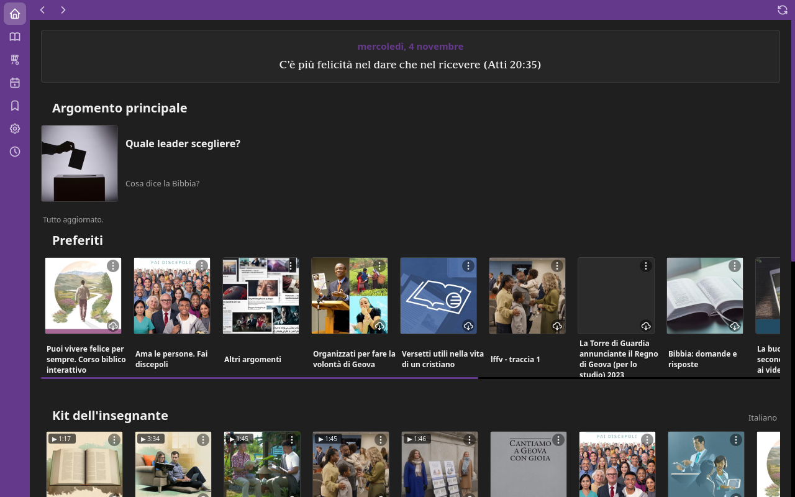
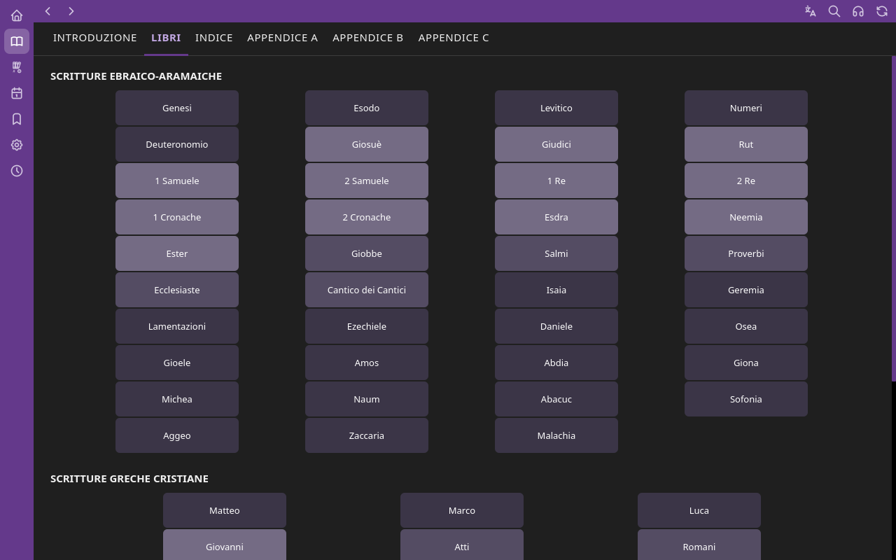
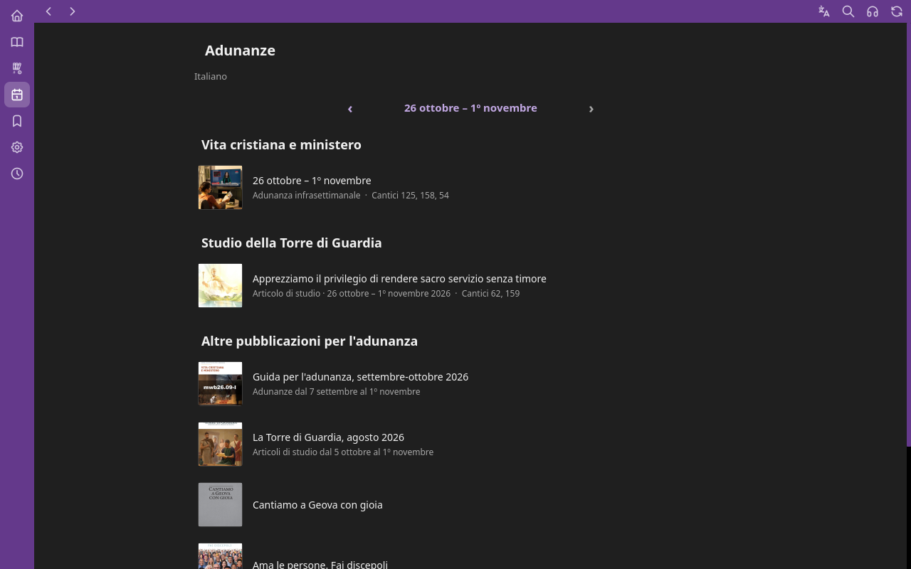

# JW-LibriX

**JW Library per Linux.** Per Linux non esiste un'app JW Library ufficiale:
questa è una ricostruzione fatta da zero, con PyQt6, che fa tutto quello che fa
l'app originale e in più alcune cose che l'originale non ha.

> Progetto non ufficiale e senza scopo di lucro. Non è affiliato né approvato
> da jw.org. I contenuti (Bibbia, pubblicazioni, video, audio) vengono
> scaricati dai server pubblici di jw.org e wol.jw.org, e restano loro.

Versione **V1** (1.0.0).

## Com'è



| Bibbia | Adunanze |
|---|---|
|  |  |

## Cosa fa

Tutto quello che ti aspetti da JW Library:

- **Bibbia**: i 66 libri, i capitoli, la scelta della lingua, il pannello dei riferimenti.
- **Biblioteca Digitale**: catalogo delle pubblicazioni con ricerca e copertine, video, audio.
- **Adunanze**: la settimana in corso (Vita cristiana e ministero, Studio della Torre di Guardia), con i contenuti multimediali di ogni pagina in ordine, e «Aggiungi file» (PDF, Word, immagini, video, audio).
- **Ricerche**: sottolineature, segnalibri, appunti e playlist, che arrivano dal backup `.jwlibrary` del telefono.
- **Scaricati**: cosa c'è sul disco, con il menu per eliminarlo.
- **Player** video e audio, mini player, e uscita su uno o più monitor esterni.
- Tema chiaro e scuro, molte lingue, modalità offline.

## Cosa c'è in più rispetto all'app originale

- Nella **Home**: il testo del giorno, l'**argomento della settimana o del giorno** preso dal sito, e **tutte le notizie** (anche quelle dell'organizzazione), novità e aggiornamenti con «Scarica».
- Barra di avanzamento viola per ogni scaricamento, e pulsante **Annulla scaricamento** ovunque.
- Il **Timer adunanze** come plugin facoltativo (vedi sotto).
- Controllo degli **aggiornamenti dell'app** dalle Impostazioni.
- I dati stanno in una cartella a parte: un aggiornamento dell'app non li tocca.

## Il Timer (plugin facoltativo)

Non è incluso. Si scarica da **Impostazioni > Plugin > Installa**, da
[JW-LibriX-timer](https://github.com/zimu96/JW-LibriX-timer), e si accende con
la spunta. Un aggiornamento dell'app non tocca il plugin, e viceversa.

## Avviare

Servono Python 3 e PyQt6 con QtWebEngine.

```bash
sudo pacman -S python python-pyqt6 python-pyqt6-webengine    # Arch
sudo apt install python3-pyqt6 python3-pyqt6.qtwebengine      # Debian/Ubuntu
sudo dnf install python3-pyqt6 python3-qt6webengine           # Fedora

./jw.sh              # avvia
./installa.sh        # facoltativo: icona e voce nel menu
```

Oppure, quando disponibile, scarica l'**AppImage** dalla pagina delle
[versioni](https://github.com/zimu96/JW-LibriX/releases).

I dettagli di come è fatta l'app stanno in [`LEGGIMI.md`](LEGGIMI.md).

## Crediti

Nasce dal porting a Linux di
[JW-Library-macOS](https://github.com/Miaosi001/JW-Library-macOS) di Dario
Ragusa (MIT), poi riscritto e ampliato. Il timer è basato su OnTime Meeting
Timer (MIT).
