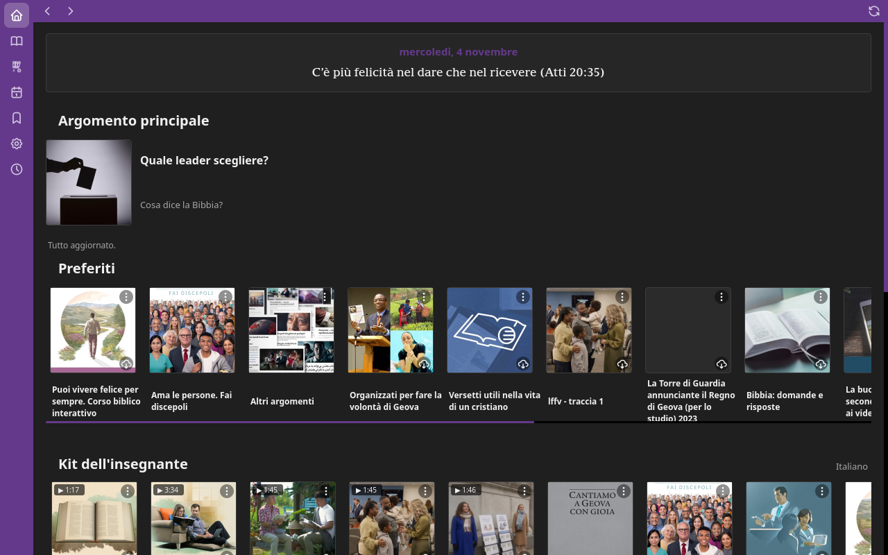
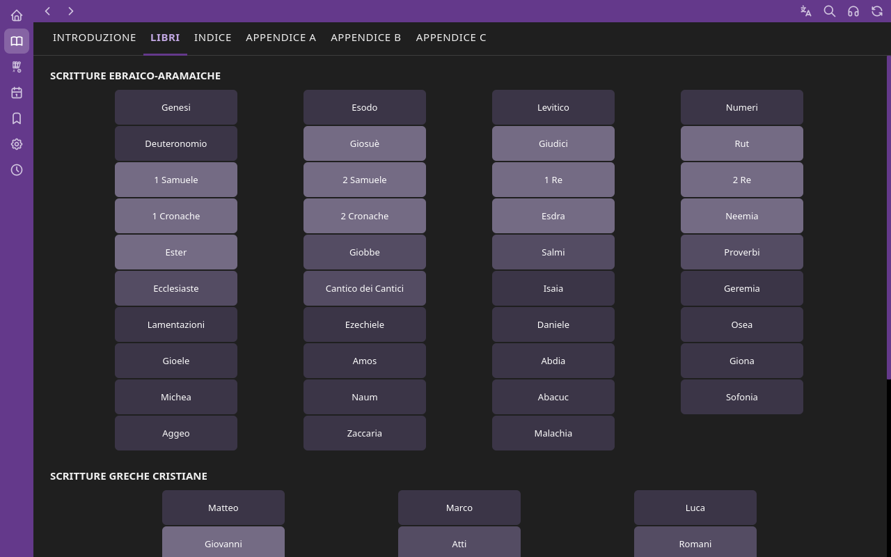
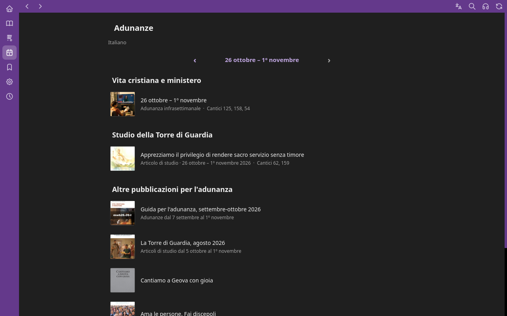
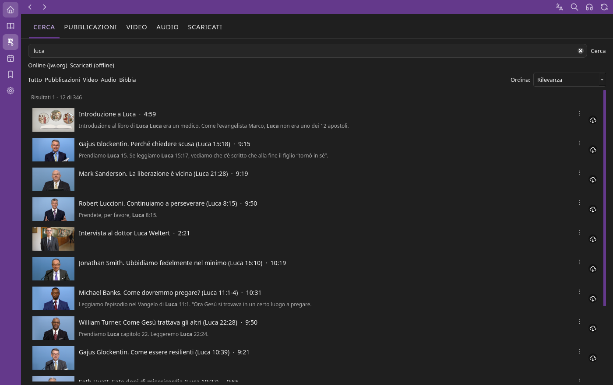

# JW-LibriX

**JW Library per Linux.** Per Linux non esiste un'app JW Library ufficiale:
questa è una ricostruzione fatta da zero, con PyQt6, che fa tutto quello che fa
l'app originale e in più alcune cose che l'originale non ha.

> Progetto non ufficiale e senza scopo di lucro. Non è affiliato né approvato
> da jw.org. I contenuti (Bibbia, pubblicazioni, video, audio) vengono
> scaricati dai server pubblici di jw.org e wol.jw.org, e restano loro.

Versione **1.1.2** (l'ultima: si scarica dalla pagina delle
[versioni](https://github.com/zimu96/JW-LibriX/releases/latest)).

## Com'è



| Bibbia | Adunanze |
|---|---|
|  |  |

| Cerca (sezione nuova: online su jw.org e offline, con scarica su ogni risultato) |
|---|
|  |

| Schermo esterno (monitor o TV della sala: video, immagini e scritture) |
|---|
|  |

## Cosa fa

Tutto quello che ti aspetti da JW Library:

- **Bibbia**: i 66 libri, i capitoli, la scelta della lingua, il pannello dei riferimenti.
- **Biblioteca Digitale**: catalogo delle pubblicazioni con ricerca e copertine, video, audio.
- **Adunanze**: la settimana in corso (Vita cristiana e ministero, Studio della Torre di Guardia), con i contenuti multimediali di ogni pagina in ordine, e «Aggiungi file» (PDF, Word, immagini, video, audio).
- **Ricerche**: sottolineature, segnalibri, appunti e playlist, che arrivano dal backup `.jwlibrary` del telefono.
- **Scaricati**: cosa c'è sul disco, con il menu per eliminarlo.
- **Player** video e audio, mini player, e uscita su uno o più monitor esterni.
- Tema chiaro e scuro, molte lingue, modalità offline.

## Novità della 1.1.2: bugfix e piccole aggiunte

Una versione di **bugfix**, con qualche piccola aggiunta di rifinitura: cose che l'app
ufficiale JW Library ha e che in JW-LibriX ancora mancavano. Insieme esce il timer **1.0.6**
(solo bugfix, vedi [JW-LibriX-timer](https://github.com/zimu96/JW-LibriX-timer)).

### Bugfix

- **Sottolineature e segnalibri anche online**: leggendo una pubblicazione dal sito (non
  scaricata, anche aperta da *Cerca*) prima non si potevano mettere; ora si sottolinea e si
  mettono i segnalibri come offline. Sono gli stessi: quello che segni online lo ritrovi nella
  pubblicazione scaricata, e viceversa. Un segnalibro di una pubblicazione non scaricata si apre
  dal sito, sul paragrafo giusto.
- **Niente più riquadri bianchi**: dove c'era la foto della pagina del libro stampato («Edizione
  stampata») ora c'è solo il testo digitale, come nell'app ufficiale: si ingrandisce e si
  sottolinea. Nel tema scuro anche le caselle («Vai più a fondo» e simili) sono scure con il
  testo chiaro.
- **Il tasto dei segnalibri** nella barra viola si colora davvero (prima il segnalibro colorato
  veniva disegnato spostato, fuori dalla barra).
- **Ricerche**: un segnalibro nuovo compare subito, senza riavviare l'app.
- **Le caselle «La tua risposta»**: quello che scrivi ora si salva da solo e lo ritrovi sia
  online sia offline (ed entra nel backup `.jwlibrary`). Anche il titolo e la scritta sopra il
  titolo si possono segnare online come offline.
- **Catalogo all'avvio**: se la schermata iniziale scaricava un catalogo nuovo, la Home restava
  quella vecchia finché non si premeva il tasto di aggiornamento. Ora si apre già aggiornata; e
  se all'accensione del PC la rete non è ancora pronta, il controllo riprova.

### Piccole aggiunte (come nell'app ufficiale)

- **Il segnalibro si vede nel testo**: accanto al paragrafo segnato compare un segnalibro del suo
  colore.
- **Colore dei segnalibri**: prima di mettere un segnalibro si sceglie il colore (gli stessi sei
  delle sottolineature), e si può cambiare dopo: dal tasto dei segnalibri nella barra viola
  («Cambia colore») o in *Ricerche* con il tasto destro.
- **Figure con più immagini**: si sfogliano una per volta, con due frecce semitrasparenti ai lati
  e dei puntini sopra l'immagine che dicono quante sono e a quale sei; dopo l'ultima si torna alla
  prima. Uguale online e offline.
- **Riviste in corso** nella Home, in fondo alla fila del Kit dell'insegnante: la rivista per il
  pubblico uscita per ultima (ora «Svegliatevi! n. 1 2026»). Le riviste escono una alla volta,
  prima la Torre di Guardia e poi Svegliatevi!: quando esce la successiva prende il posto della
  precedente da sola.
- **Preferiti**: «Metti nei Preferiti» anche nei tre puntini di audio e video della Biblioteca
  Digitale e per gli articoli trovati con *Cerca*.

## Novità della 1.1.1

**I riferimenti si aprono a destra, anche leggendo online.** Quando leggi una
pubblicazione dal sito (non scaricata), un versetto o una pubblicazione citata non
apre più un'altra pagina: si apre nel riquadro di destra, come per le pubblicazioni
scaricate, con la barra viola, la freccia indietro e la X. Il testo del riquadro segue
lo zoom dell'app.

- Se la pubblicazione citata è già sul tuo PC si legge da lì, senza avvisi; se non lo è
  compare l'avviso «non scaricata» (sparisce da solo) con il tasto **Scarica** e la barra
  di avanzamento.
- Nella Bibbia letta online i riferimenti si trovano anche con i controlli automatici
  spenti, e la **gemma** funziona senza la Bibbia scaricata (serve la Guida alle ricerche).

## Novità della 1.1.0

**Cerca su jw.org, dentro l'app.** In *Biblioteca Digitale* c'è una scheda nuova,
**Cerca**, la prima e quella che si apre per default. Scrivi una parola (per
esempio «luca» o «matteo»): mentre scrivi compare una tendina con i suggerimenti,
presi sia da quello che hai già scaricato sia da jw.org. Premendo **Invio** si apre
la pagina dei risultati, come quella del sito ma nello stile dell'app:

- due sezioni separate: **Online (jw.org)**, con gli stessi risultati del sito, e **Scaricati (offline)**, con quello che trovi nel testo già sul disco;
- le schede **Tutto, Pubblicazioni, Video, Audio, Bibbia**, l'ordine (rilevanza, dal più recente, dal meno recente) e le pagine numerate;
- senza internet resta solo la parte offline.

**Apri senza scaricare.** Ogni pubblicazione, e la Bibbia, si può leggere online dentro l'app:
in alto compare un avviso («non è scaricata») con il tasto **Scarica**, che sparisce da solo.
I video e gli audio trovati partono nel lettore dell'app, in streaming.

**Scarica da qualunque risultato.** Accanto a ogni pubblicazione, rivista, video o audio c'è
la nuvoletta di scaricamento (per i video si sceglie la risoluzione), con la barra di
avanzamento e una spunta verde quando è già scaricato. Il menu dei tre puntini permette
di aprire subito, scaricare e mettere nei **Preferiti**, anche per ciò che è solo online.
Quello che scarichi finisce negli stessi elenchi di Scaricati e delle sezioni normali.

**Solo se non c'è altro:** se una pubblicazione esiste solo in PDF, si apre online e si
può scaricare; va in Scaricati e nella categoria «Altri formati (PDF)».

**Aggiornamenti.** Il popup di aggiornamento mostra le novità della nuova versione
(prese dalle note della release); il timer compare solo se è installato.

## Cosa c'è in più rispetto all'app originale

- Nella **Home**: il testo del giorno, l'**argomento della settimana o del giorno** preso dal sito, e **tutte le notizie** (anche quelle dell'organizzazione), novità e aggiornamenti con «Scarica».
- Barra di avanzamento viola per ogni scaricamento, e pulsante **Annulla scaricamento** ovunque.
- Il **Timer adunanze** come plugin facoltativo (vedi sotto).
- Controllo degli **aggiornamenti** all'avvio (app e, se installato, timer): un popup con una barra scarica tutto in un clic. Si può fare anche a mano dalle Impostazioni.
- I dati stanno in una cartella a parte: un aggiornamento dell'app non li tocca.

## Il Timer (plugin facoltativo)

Non è incluso. Si scarica da **Impostazioni > Plugin > Installa**, da
[JW-LibriX-timer](https://github.com/zimu96/JW-LibriX-timer), e si accende con
la spunta. Un aggiornamento dell'app non tocca il plugin, e viceversa.

## Avviare

Servono Python 3 e PyQt6 con QtWebEngine.

```bash
sudo pacman -S python python-pyqt6 python-pyqt6-webengine    # Arch
sudo apt install python3-pyqt6 python3-pyqt6.qtwebengine      # Debian/Ubuntu
sudo dnf install python3-pyqt6 python3-qt6webengine           # Fedora

./jw.sh              # avvia
./installa.sh        # facoltativo: icona e voce nel menu
```

## AppImage (la via più semplice)

Un solo file, senza installare Python né PyQt6: va bene su qualunque distribuzione
Linux a 64 bit. Si scarica dalla pagina delle
[versioni](https://github.com/zimu96/JW-LibriX/releases).

Il nome del file contiene il numero della versione (oggi
`JW-LibriX-V1.1.2-x86_64.AppImage`); nei comandi qui sotto l'asterisco va bene
per qualunque versione.

**1. Mettila in una cartella fissa.** Consigliata, valida su ogni distro:

```bash
mkdir -p ~/Applications
mv ~/Scaricati/JW-LibriX-*-x86_64.AppImage ~/Applications/
chmod +x ~/Applications/JW-LibriX-*-x86_64.AppImage
```

**2. Avviala** con doppio clic o dal terminale:

```bash
~/Applications/JW-LibriX-*-x86_64.AppImage
```

Poi si aggiorna da sola: all'avvio controlla se c'è una versione nuova, la
scarica al posto di quella vecchia e si riavvia.

**Il menu delle applicazioni e l'icona.** Al primo avvio l'AppImage crea da sola
la voce **JW LibriX** nell'elenco delle applicazioni, con la sua icona viola
(`~/.local/share/applications/JWLibriX.desktop` e le icone in
`~/.local/share/icons/hicolor/`). Non c'è nient'altro da installare.

- La voce nel menu **è solo un collegamento al file AppImage**, con il suo percorso
  scritto dentro. Per questo conviene metterla subito nel posto definitivo.
- Se **sposti** l'AppImage, avviala una volta dalla nuova posizione: il
  collegamento si aggiorna da solo. Finché non lo fai, la voce nel menu punta al
  vecchio percorso e non parte.
- Se la **cancelli**, togli anche la voce:
  `rm ~/.local/share/applications/JWLibriX.desktop`
- Per non creare mai la voce nel menu: `JWL_NO_INTEGRAZIONE=1 ./JW-LibriX-*-x86_64.AppImage`

**I tuoi dati restano fuori dall'AppImage**, nella cartella dati (di solito
`~/.local/share/JW-LibriX`, o quella che scegli al primo avvio): database,
pubblicazioni, video, immagini e il plugin timer. Sostituire o aggiornare
l'AppImage non li tocca.

Se invece preferisci i sorgenti, vedi «Avviare» qui sopra.

I dettagli di come è fatta l'app stanno in [`LEGGIMI.md`](LEGGIMI.md).

## Crediti

Nasce dal porting a Linux di
[JW-Library-macOS](https://github.com/Miaosi001/JW-Library-macOS) di Dario
Ragusa (MIT), poi riscritto e ampliato. Il timer è basato su OnTime Meeting
Timer (MIT).
